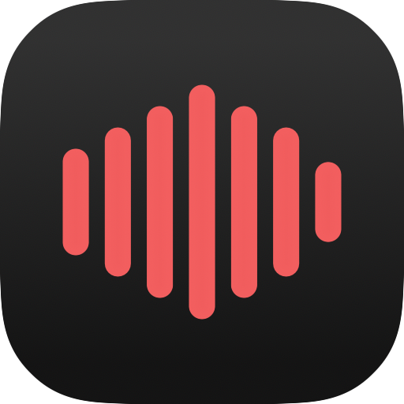

<p align="center">
    
</p>

<h1 align="center">Audexis</h1>

<p align="center">A cross platform music player.</p>

<p align="center">
  <a href="#getting-started">Getting started</a> ·
  <a href="#Apps">Apps</a> ·
  <a href="CONTRIBUTING.md">Contributing</a> ·
  <a href="SUPPORT.md">Support</a>
</p>

Audexis is for people who keep their own music library. Browse and play local
files, edit their metadata, and keep library data on your computer. Optional
server that connect that library to mobile clients (can self-host).

The desktop app is being rebuilt with Freya, trying to use as little memory as
possible. The iOS client is in development and theAndroid client
will be developed eventually.

## Features

- Scan and monitor local music folders.
- Browse and search songs, albums, and artists.
- Manage playlists, favorites, and the playback queue.
- Use shuffle, repeat, and native system media controls.
- Read and edit embedded metadata, including custom fields.
- Display artwork and synced or unsynced lyrics.
- Store the local library in SQLite.
- Connect to an optional server for library sync and mobile access.

Features vary between apps.

## Getting started

### Desktop

Install a Rust toolchain with support for edition 2024, then run from the
repository root:

```sh
cargo run -p audexis
```

Choose your music folders in the app to build a local library. For development
that changes tags or files, use copies of your music.

Build the release executable with:

```sh
cargo build -p audexis --release
```

If you use Just, `just dev` starts the app. `just build` creates desktop packages
and requires Cargo Packager. See the [desktop README](apps/desktop/README.md)
for more details.

### Website, server, and mobile

Each has its own setup and dependencies:

- [Website](apps/www/README.md): Astro site, documentation, accounts, and billing.
- [Server](crates/audexis_server/README.md): cloud API, PostgreSQL, and media storage.
- [iOS](apps/ios/README.md): Xcode project and Rust mobile integration.
- [Android](apps/android/README.md): Android Studio project and current status.

### Apps

| Component                         | Purpose                                            |
| --------------------------------- | -------------------------------------------------- |
| [desktop](apps/desktop/README.md) | Rust and Freya desktop music player                |
| [www](apps/www/README.md)         | Astro website, documentation, and account services |
| [ios](apps/ios/README.md)         | Native SwiftUI mobile client                       |
| [android](apps/android/README.md) | Android app scaffolding                            |

### Rust crates

| Crate                                                 | Purpose                                         |
| ----------------------------------------------------- | ----------------------------------------------- |
| [audexis_core](crates/audexis_core/README.md)         | Library data, metadata, file watching, and sync |
| [audexis_audio](crates/audexis_audio/README.md)       | decoding, audio output, and playback state      |
| [audexis_protocol](crates/audexis_protocol/README.md) | Shared cloud records and wire types             |
| [audexis_mobile](crates/audexis_mobile/README.md)     | Persistent mobile library and C interface       |
| [audexis_server](crates/audexis_server/README.md)     | Cloud library and media server                  |

The root Cargo workspace defaults to the desktop application. Use `-p` to
select a package or `--workspace` to check all Rust packages.

## Audio formats

Audexis recognizes MP3, MP2, MP1, FLAC, M4A, M4B, MP4, Ogg, Opus, OGA, SPX,
OGV, MOV, M4V, and QuickTime files. Playback and metadata support depend on the
codec and container, and differ between native clients (for now).

## Development priorities

- Improve testing, error handling, and metadata compatibility.
- Continue the desktop rewrite and mobile clients.
- Expand library organization, including smart playlists and tag normalization.
- Add more artwork customization and ways to organize files from their tags.

These are areas of interest rather than release commitments. Propose specific
changes through the [contribution process](CONTRIBUTING.md).

## Contributing and support

Bug reports, documentation, accessibility improvements, and focused code
contributions are welcome.

- [Contributing](CONTRIBUTING.md): setup, checks, and contribution expectations.
- [Support](SUPPORT.md): questions, bug reports, and troubleshooting information.
- [Security](SECURITY.md): reporting vulnerabilities privately.
- [Code of conduct](CODE_OF_CONDUCT.md): expectations for project participation.

## License

Audexis is under the [MIT License](LICENSE).
